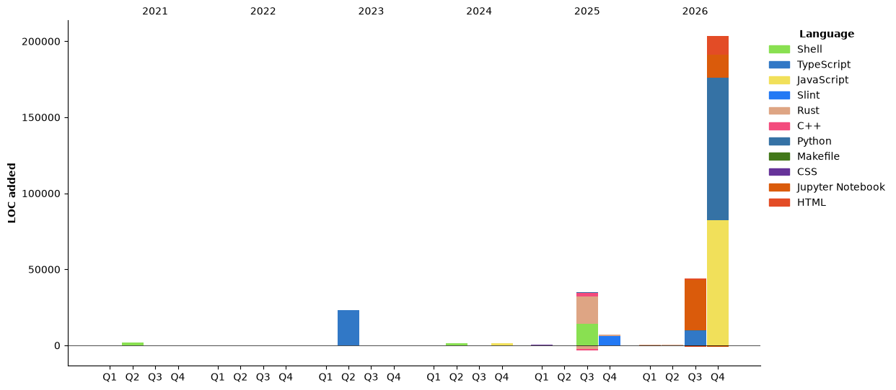

<!-- Banner -->


<p align="center">
  
  
  
</p>

<h1 align="center">Hi, I'm Rahmath (ferozeren)</h1>
<h3 align="center">AI Engineer · Data Scientist · ML Engineer</h3>

<p align="center">
  I design and ship end-to-end AI systems, combining <strong>multi-agent workflows</strong>, <strong>predictive ML models</strong>, and <strong>high-performance backends</strong> in Python and Rust. Focused on turning raw data and LLM capabilities into reliable, production-grade software.
</p>

<br />

- 🤖 **Agentic AI & LLMs:** Multi-agent orchestration (LangGraph, CrewAI, AutoGen), RAG pipelines, and MCP integrations
- 📊 **Machine Learning & Data:** End-to-end modeling, evaluation, and analytics with PyTorch, Scikit-Learn, and Python
- ⚡ **Systems & Backend:** High-speed CLI tools in Rust alongside scalable APIs with FastAPI, Docker, and PostgreSQL

---

<!-- Featured Projects -->
<h2 align="center">🚀 Featured Projects</h2>

<table>
  <tr>
    <td width="50%" valign="top">
      <h3>
        <a href="https://github.com/ferozeren/comparative-ml-modeling/tree/main/liver_patient_records_classification">📔 Liver Patient Records Classification</a>
      </h3>
      <p>
        Compares multiple ML classification models to predict liver disease from patient records.
      </p>
      
      
    </td>
    <td width="50%" valign="top">
      <h3>
        <a href="https://github.com/ferozeren/mosm-rs">🌦️ Weather Application</a>
      </h3>
      <p>
        A lightweight terminal app written in Rust for checking current weather forecasts.
      </p>
      
    </td>
  </tr>
  <tr>
    <td width="50%" valign="top">
      <h3>
        <a href="https://github.com/ferozeren/horse_health">🐎 Horse Health Prediction</a>
      </h3>
      <p>
        A Streamlit web app using a KNN classifier to predict horse health outcomes.
      </p>
      
      
      
    </td>
    <td width="50%" valign="top">
      <h3>
        <a href="https://github.com/ferozeren/amazon-crewai">🌐 Amazon CrewAI Prediction</a>
      </h3>
      <p>
        A Python and CrewAI project that analyzes Amazon laptop listings to spot trends and deals.
      </p>
      
      
    </td>
  </tr>
  <tr>
    <td width="50%" valign="top">
      <h3>
        <a href="https://github.com/ferozeren/google_ridge_regression">📈 Google Stock Price Prediction</a>
      </h3>
      <p>
        Compares Linear and Ridge regression for modeling Google's daily closing prices, with hyperparameter tuning and residual analysis.
      </p>
      
      
      
    </td>
    <td width="50%" valign="top">
      <h3>
        <a href="https://github.com/ferozeren/pandas_prac">🐼 Exploratory Data Analysis & Feature Engineering</a>
      </h3>
      <p>
        Hands-on pandas data cleaning, filtering, and exploratory analysis using a real Pokémon dataset.
      </p>
      
      
      
    </td>

  </tr>
</table>

---

<!-- Tech Stack Badges -->
<h2 align="center">🛠️ Tech Stack</h2>

<h4 align="center">🧠 Data Science & Machine Learning</h4>
<p align="center">
  
  
  
  
  
  
  
  
  
</p>

<h4 align="center">🤖 Generative AI, Agentic AI & LLMs</h4>
<p align="center">
  
  
  
  
  
  
  
  
</p>

<h4 align="center">📊 Data Analytics & Visualization</h4>
<p align="center">
  
  
  
  
</p>

<h4 align="center">🌐 Web Development & Backend</h4>
<p align="center">
  
  
  
  
  
  
</p>

<h4 align="center">🗄️ Databases & Cloud</h4>
<p align="center">
  
  
  
  
  
</p>

<h4 align="center">⚙️ MLOps, Deployment & Developer Tools</h4>
<p align="center">
  
  
  
  
  
  
  
  
</p>

---

<!-- GitHub Stats -->
<h2 align="center">📊 GitHub Stats</h2>

<!--START_SECTION:waka-->


📊 **This Week I Spent My Time On** 

```text
💬 Programming Languages: 
Python                   12 hrs 55 mins      ███████████████░░░░░░░░░░   58.54 % 
Markdown                 7 hrs 31 mins       █████████░░░░░░░░░░░░░░░░   34.14 % 
Other                    28 mins             █░░░░░░░░░░░░░░░░░░░░░░░░   02.19 % 
JavaScript               18 mins             ░░░░░░░░░░░░░░░░░░░░░░░░░   01.38 % 
YAML                     17 mins             ░░░░░░░░░░░░░░░░░░░░░░░░░   01.34 % 
```

**I Mostly Code in Rust** 

```text
Jupyter Notebook         6 repos             ████░░░░░░░░░░░░░░░░░░░░░   16.22 % 
Python                   4 repos             ███░░░░░░░░░░░░░░░░░░░░░░   10.81 % 
TypeScript               3 repos             ██░░░░░░░░░░░░░░░░░░░░░░░   08.11 % 
JavaScript               2 repos             █░░░░░░░░░░░░░░░░░░░░░░░░   05.41 % 
HTML                     1 repo              █░░░░░░░░░░░░░░░░░░░░░░░░   02.70 % 
```


**Timeline**




<!--END_SECTION:waka-->

---

<!-- Thought of the Day -->
<h2 align="center">🌟 Thought of the Day</h2>
<p align="center">
  
</p>

---

<!-- Connect -->
<h2 align="center">🤝 Connect With Me</h2>
<p align="center">
  <a href="mailto:ferozeren.60@gmail.com" target="_blank"></a>&nbsp;
  <a href="https://x.com/ferozeren60" target="_blank"></a>&nbsp;
  <a href="https://www.github.com/ferozeren" target="_blank"></a>&nbsp;
  <a href="https://www.linkedin.com/in/mdrahmathalikhan/" target="_blank"></a>
</p>

<br />

<!-- Footer -->
<p align="center">
  
</p>
